# Блокнот D
## Файл 1: Базовая модуляция (01 - Baseband Modulation)
В данном файле рассматриваются основы цифровой модуляции в основной полосе частот (Baseband Modulation). Модуляция в основной полосе представляет собой процесс отображения информационных бит в комплексные символы определенного созвездия (констелляции) до их переноса на промежуточную (ПЧ) или радиочастоту (РЧ).

В качестве основных схем модуляции исследуются:
* **BPSK (Binary Phase Shift Keying)** — двоичная фазовая манипуляция;
* **QPSK (Quadrature Phase Shift Keying)** — квадратурная фазовая манипуляция;
* **QAM (Quadrature Amplitude Modulation)** — квадратурная амплитудная модуляция (на примере 16-QAM).

### 1. Двоичная фазовая манипуляция (BPSK)
В схеме BPSK каждому биту ставится в соответствие один символ. Используется только синфазный (I, вещественный) канал. Переход между символами соответствует изменению фазы несущей на $180^\circ$ ($\pi$ радиан).

Для генерации битовой последовательности и её отображения в символы BPSK используется следующий код:
```python
import numpy as np
import matplotlib.pyplot as plt

# Генерация случайной последовательности бит
bits = np.random.randint(0, 2, 16)

# Определение созвездия BPSK и отображение бит в символы
bpsk_scheme = [-1+0j, 1+0j]
bpsk_symbols = [bpsk_scheme[i] for i in bits]

# Построение созвездия
plt.figure(figsize=(5, 5))
plt.scatter(np.real(bpsk_symbols), np.imag(bpsk_symbols))
plt.title('BPSK constellation diagram')
plt.xlabel('Channel 1 amplitude (I)')
plt.ylabel('Channel 2 amplitude (Q)')
plt.grid(True)
plt.show()
```
На диаграмме созвездия точки располагаются исключительно на горизонтальной оси (I), так как мнимая квадратурная составляющая (Q) равна нулю:  

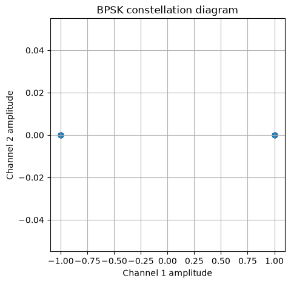  

### 2. Квадратурная фазовая манипуляция (QPSK)
При переходе к QPSK задействуется квадратурный канал (Q), что позволяет кодировать 2 бита в одном передаваемом символе. Созвездие состоит из 4 точек с постоянной амплитудой и разницей фаз в $90^\circ$ между соседними состояниями.

Отображение пар бит ($00 \to 0, 01 \to 1, 10 \to 2, 11 \to 3$) реализуется следующим скриптом:
```python
# Определение созвездия QPSK
qpsk_scheme = [1+1j, 1-1j, -1+1j, -1-1j]

# Генерация целочисленных индексов от 0 до 3 (пары бит)
ints = np.random.randint(0, 4, 1024)
qpsk_symbols = [qpsk_scheme[i] for i in ints]

# Построение созвездия QPSK
plt.figure(figsize=(5, 5))
plt.scatter(np.real(qpsk_symbols), np.imag(qpsk_symbols))
plt.title('QPSK constellation diagram')
plt.xlabel('Channel 1 amplitude (I)')
plt.ylabel('Channel 2 amplitude (Q)')
plt.grid(True)
plt.show()
```
Созвездие имеет 4 четко выраженных квадратурных состояния:  

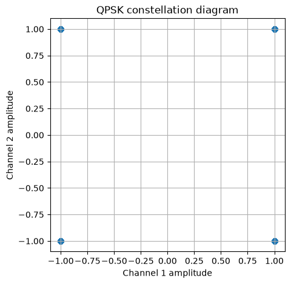  

### 3. Квадратурная амплитудная модуляция (16-QAM)
В многоуровневых схемах модуляции, таких как 16-QAM, информация кодируется изменением как фазы, так и амплитуды. Каждый символ переносит $k = 4$ бита (16 возможных комбинаций в диапазоне от 0 до 15).

Генерация и визуализация созвездия 16-QAM:
```python
# Определение созвездия 16-QAM
qam_scheme = [-3-3j, -3-1j, -3+3j, -3+1j,  \
              -1-3j, -1-1j, -1+3j, -1+1j,  \
               3-3j,  3-1j,  3+3j,  3+1j,  \
               1-3j,  1-1j,  1+3j,  1+1j]

ints = np.random.randint(0, 16, 1024)
qam_symbols = [qam_scheme[i] for i in ints]

plt.figure(figsize=(5, 5))
plt.scatter(np.real(qam_symbols), np.imag(qam_symbols))
plt.title('16-QAM constellation diagram')
plt.xlabel('Channel 1 amplitude (I)')
plt.ylabel('Channel 2 amplitude (Q)')
plt.grid(True)
plt.show()
```
Диаграмма созвездия 16-QAM представляет собой решетку из 16 точек:  

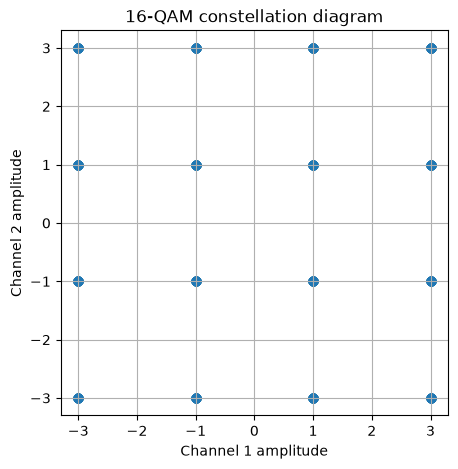

Повышение порядка модуляции (64-QAM, 256-QAM и вплоть до 1024-QAM) позволяет существенно увеличить спектральную эффективность и пропускную способность канала, однако делает систему более чувствительной к шумам и искажениям.

---

## Файл 2: Оценка качества канала: EVM и BER (02 - EVM and BER)
В данном файле рассматривается воздействие аддитивного белого гауссовского шума (AWGN, Additive White Gaussian Noise) на модулированные сигналы и исследуются ключевые метрики качества радиолинии: отношение сигнал/шум (SNR), амплитуда вектора ошибки (EVM) и коэффициенты ошибок по битам (BER) и символам (SER).

### 1. Моделирование шума AWGN и SNR
Тепловой шум в приёмном тракте моделируется нормальным распределением с нулевым математическим ожиданием ($\mu = 0$) и дисперсией $\sigma^2$:
$$
p(x) = \frac{1}{\sqrt{2\pi\sigma^2}} e^{-\frac{x^2}{2\sigma^2}}
$$
Отношение сигнал/шум определяется мощностью полезного сигнала $P_s$ и мощностью шума $P_n$:
$$
\text{SNR} = \frac{P_s}{P_n}, \quad \text{SNR}_{\text{dB}} = 10\log_{10}(P_s) - 10\log_{10}(P_n)
$$
Для комплексного сигнала шум делится поровну между вещественной и мнимой компонентами:
```python
def awgn(signal, snr):
    sig_power = np.mean(np.abs(signal)**2)
    sig_power_db = 10 * np.log10(sig_power)

    noise_power_db = sig_power_db - snr
    noise_power = 10**(noise_power_db / 10)

    complex_noise = np.sqrt(noise_power / 2) * (np.random.randn(len(signal)) + \
                                                np.random.randn(len(signal)) * 1j)
    return signal + complex_noise
```
Пример зашумления созвездий QPSK и 16-QAM:
```python
# Зашумленный сигнал QPSK при SNR = 10 дБ
qpsk_symbols_noisy = awgn(qpsk_symbols, 10)

plt.figure(figsize=(5, 5))
plt.scatter(qpsk_symbols_noisy.real, qpsk_symbols_noisy.imag)
plt.scatter(np.real(qpsk_scheme), np.imag(qpsk_scheme), s=120, c='red', marker='x')
plt.grid(True)
plt.title('QPSK constellation diagram at 10dB')
plt.xlabel('I amplitude')
plt.ylabel('Q amplitude')
plt.legend(('Received symbols', 'Reference points'), loc='upper left')
plt.show()
```
Диаграмма зашумленного созвездия QPSK (10 дБ) и созвездия 16-QAM (20 дБ и 10 дБ): 

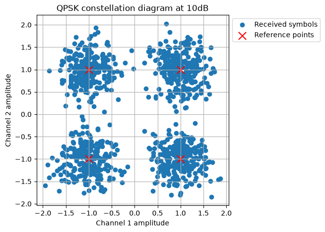

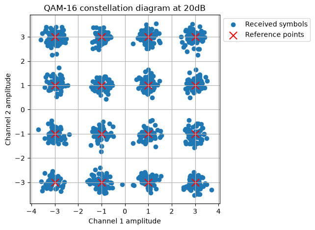

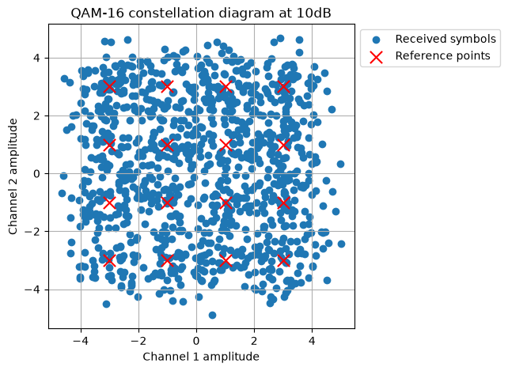

При низком значении SNR (10 дБ) точки созвездия 16-QAM размываются в сплошные области, что приводит к ошибочным решениям демодулятора.

### 2. Амплитуда вектора ошибки (EVM)
EVM (Error Vector Magnitude) измеряет среднеквадратичное отклонение принятых точек созвездия относительно идеальных опорных позиций:
$$
\text{EVM}_{\text{RMS}} = \frac{\sqrt{\frac{1}{N} \sum_{n=1}^{N} \left[(I_{rx}(n) - I_0(n))^2 + (Q_{rx}(n) - Q_0(n))^2\right]}}{\sqrt{\frac{1}{N} \sum_{n=1}^{N} (I_0^2(n) + Q_0^2(n))}} \times 100\%
$$
Функция вычисления EVM:
```python
def calculate_evm(symbols_tx, symbols_rx):
    evm_rms = np.sqrt(np.mean(np.abs(symbols_rx - symbols_tx)**2)) / \
              np.sqrt(np.mean(np.abs(symbols_tx)**2))
    return evm_rms * 100

print("QAM-16 EVM at 20dB: {:.2f}%".format(calculate_evm(qam_symbols_20db, qam_symbols)))
print("QAM-16 EVM at 10dB: {:.2f}%".format(calculate_evm(qam_symbols_10db, qam_symbols)))
```
Для 16-QAM при SNR = 20 дБ величина EVM составляет около 10%, а при снижении SNR до 10 дБ ошибка возрастает до ~30%.

### 3. Вероятность битовой (BER) и символьной (SER) ошибки
Коэффициент битовых ошибок определяется соотношением числа ошибочно принятых бит $N_e$ к общему числу переданных бит $N$:
$$
\text{BER} = \frac{N_e}{N}
$$
Расчет кривых помехоустойчивости проводится относительно нормированной энергии бита к спектральной плотности шума ($E_b/N_0$):
$$
\text{SNR} = \frac{E_b}{N_0} + 10\log_{10}(k) - 10\log_{10}(n)
$$
где $k$ — число бит на символ, а $n$ — число отсчетов на символ ($sps$).

Демодуляция BPSK и расчет кривой BER:
```python
def bpsk_demodulate(symbols):
    return np.array([1 if s.real >= 0 else 0 for s in symbols])

ebno_range = np.arange(-10, 10)
ber_bpsk = []

for ebno in ebno_range:
    bits_tx = np.random.randint(0, 2, 75000)
    bpsk_symbols = [bpsk_scheme[i] for i in bits_tx]
    bpsk_symbols_rx = awgn(bpsk_symbols, ebno)
    bits_rx = bpsk_demodulate(bpsk_symbols_rx)
    ber_bpsk.append(np.sum(bits_rx != bits_tx) / len(bits_tx))

plt.semilogy(ebno_range, ber_bpsk)
plt.xlabel('Eb/No, dB')
plt.ylabel('Bit Error Rate')
plt.title('BPSK BER')
plt.grid(True)
plt.show()
```
График зависимости BER от $E_b/N_0$ для BPSK:  

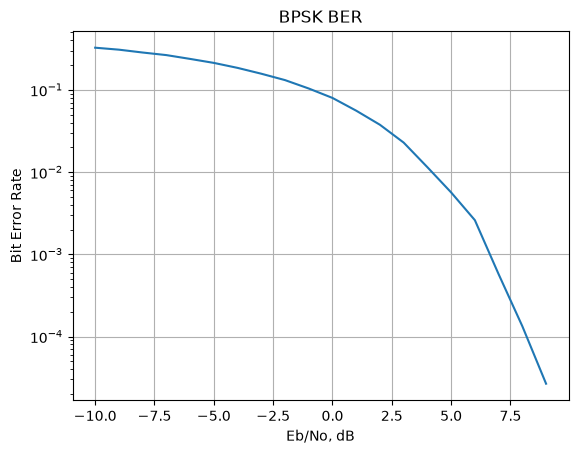

Для схемы QPSK дополнительно рассчитывается частота символьных ошибок (SER). Поскольку один символ несет два бита, ошибка в одном символе не обязательно означает ошибку в обоих битах, поэтому $\text{SER} \ge \text{BER}$:
```python
def qpsk_demodulate(symbols):
    demodded = []
    for s in symbols:
        if s.real >= 0:
            demodded.append(0 if s.imag >= 0 else 1)
        else:
            demodded.append(2 if s.imag >= 0 else 3)
    return np.array(demodded)

binary_mapping = {0: (0, 0), 1: (0, 1), 2: (1, 0), 3: (1, 1)}

ser_qpsk, ber_qpsk = [], []
for ebno in ebno_range:
    ints_tx = np.random.randint(0, 4, 50000)
    qpsk_symbols = [qpsk_scheme[i] for i in ints_tx]
    snr = ebno + 10 * np.log10(2)
    qpsk_symbols_rx = awgn(qpsk_symbols, snr)
    ints_rx = qpsk_demodulate(qpsk_symbols_rx)

    ser_qpsk.append(np.sum(ints_rx != ints_tx) / len(ints_tx))

    bits_tx = np.array([binary_mapping[s] for s in ints_tx]).reshape(-1)
    bits_rx = np.array([binary_mapping[s] for s in ints_rx]).reshape(-1)
    ber_qpsk.append(np.sum(bits_tx != bits_rx) / len(bits_tx))

plt.semilogy(ebno_range, ber_qpsk, label='QPSK BER')
plt.semilogy(ebno_range, ser_qpsk, label='QPSK SER')
plt.title('QPSK Error Rates')
plt.xlabel('Eb/No, dB')
plt.ylabel('Error Rate')
plt.legend()
plt.grid(True)
plt.show()
```
Сравнение кривых BER и SER для QPSK:  

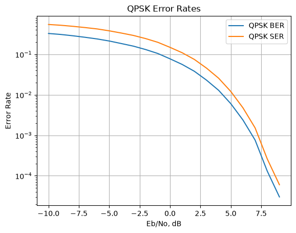

---

## Файл 3: Формирование импульсов (03 - Pulse Shaping)
В данном файле рассматриваются методы формирования формы импульсов (Pulse Shaping) для ограничения полосы излучаемого радиосигнала и подавления межсимвольной интерференции (МСИ, Inter-Symbol Interference — ISI).

### 1. Проблема передачи неформированных импульсов
Передача идеальных дельта-импульсов во временной области приводит к излучению во всей полосе частот, создавая сильные внеполосные помехи:
```python
symbols = generate_bpsk(2048)

# Спектр неформированных BPSK импульсов
fs = 128
fft_size = 2048
y_fft = np.fft.fftshift(np.fft.fft(generate_bpsk(fft_size), fft_size))[int(fft_size/2):]
freqs = np.fft.fftshift(np.fft.fftfreq(fft_size, 1/fs))[int(fft_size/2):]

plt.plot(freqs, np.abs(y_fft))
plt.xlabel('Frequency, Hz')
plt.ylabel('Magnitude')
plt.title('BPSK Pulses in Frequency Domain')
plt.show()
```
Спектр импульсов занимает всю доступную полосу: 

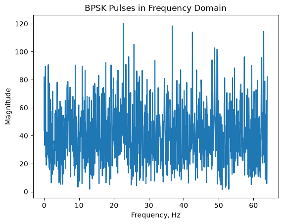

### 2. Прямоугольные импульсы и согласованная фильтрация
Простейший способ — повторение каждого символа $N$ раз ($sps$, отсчетов на символ). Однако резкие фронты прямоугольного импульса порождают медленно спадающие боковые лепестки спектра ($\text{sinc}$-образная огибающая):
```python
N = 8
symbols_square_shaped = np.repeat(symbols, N)

# Скользящее среднее на приеме (согласованный фильтр)
weights = [0.25, 0.25, 0.25, 0.25]
filtered_symbols = np.convolve(np.repeat(symbols, 4).real, weights)

plt.stem(filtered_symbols.real[:64])
plt.plot(filtered_symbols.real[:64])
plt.title('Filtered Square Pulses (Moving Average)')
plt.show()
```
В результате свертки формируются треугольные максимумы (точки принятия решений), но уровень боковых лепестков спектра все еще остается высоким:  

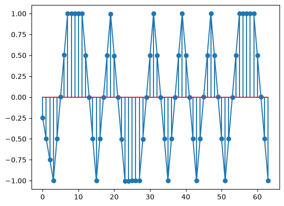

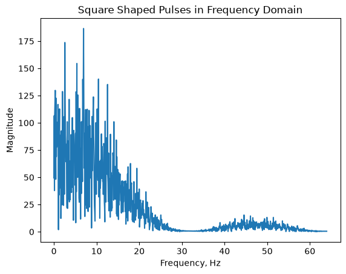

### 3. Фильтр на основе функции Sinc
Идеальный фильтр типа «кирпичная стена» (brick-wall) с прямоугольной передаточной характеристикой во временной области описывается функцией $\text{sinc}$:
$$
p(t) = \frac{\sin(\pi t / T)}{\pi t / T} = \text{sinc}(t/T)
$$
На практике бесконечный импульсный отклик усекают:
```python
T = 1
sps = 5
num_weights = 251
x = np.arange(-int(num_weights/2), int(num_weights/2)+1, 1) / sps / T
sinc_weights = np.sinc(x)

plt.plot(x, sinc_weights)
plt.title('Sinc function')
plt.xlabel('Time samples, t')
plt.ylabel('p(t)')
plt.show()
```
Форма функции $\text{sinc}$ во времени:  

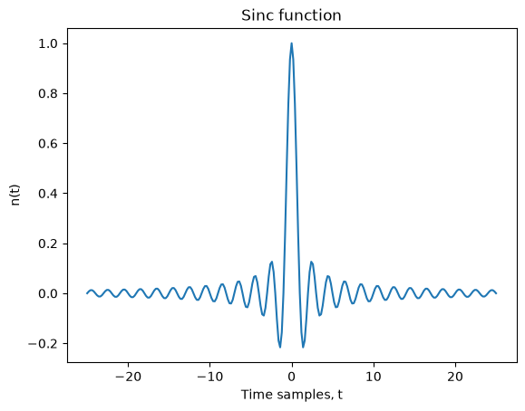

Увеличение длины усечения приближает амплитудно-частотную характеристику фильтра к идеальному прямоугольнику:  

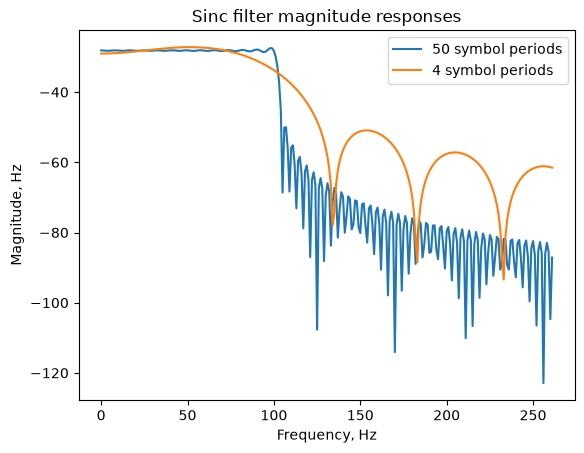

### 4. Фильтр приподнятого косинуса (Raised Cosine — RC)
Для ускорения затухания боковых лепестков во временной области применяется фильтр приподнятого косинуса с коэффициентом скругления (roll-off factor) $\alpha \in [0, 1]$:
$$
p(t) = \left(\frac{\sin(\pi t / T)}{\pi t / T}\right) \left(\frac{\cos(\alpha \pi t / T)}{1 - (2\alpha t / T)^2}\right)
$$
При $\alpha = 0$ характеристика эквивалентна функции $\text{sinc}$. При увеличении $\alpha$ хвосты импульса затухают быстрее, что упрощает реализацию фильтра, но расширяет занимаемую полосу частот:
```python
sps = 5
num_weights = 101
x = 0.9999 * np.arange(-int(num_weights/2), int(num_weights/2)+1, 1) / sps
alphas = [0, 0.25, 0.5, 0.75]

for alpha in alphas:
    rc_weights = np.sinc(x) * (np.cos(alpha*np.pi*x) / (1 - ((2*alpha*x)**2)))
    plt.plot(x, rc_weights)

plt.legend([r'$\alpha = 0$', r'$\alpha = 0.25$', r'$\alpha = 0.5$', r'$\alpha = 0.75$'])
plt.title('Raised Cosine Impulse Responses')
plt.xlabel('Time samples, t')
plt.ylabel('p(t)')
plt.show()
```
Импульсные и частотные характеристики фильтра приподнятого косинуса:  

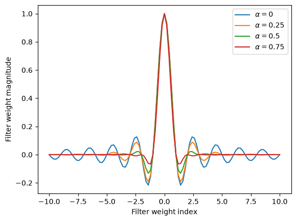

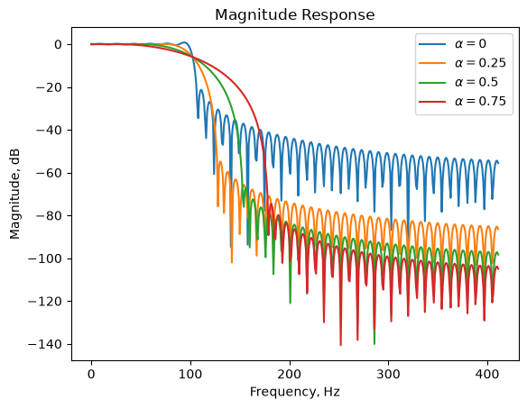

Фильтр RC удовлетворяет первому критерию Найквиста: в моменты отсчетов соседних символов $t = k T$ ($k \ne 0$) отклик строго равен нулю, что гарантирует **отсутствие межсимвольной интерференции (нулевую МСИ)**:
```python
# Формирование 3 импульсов с задержкой в 1 символ
pulse1, pulse2, pulse3 = np.zeros(21), np.zeros(21), np.zeros(21)
pulse1[5], pulse2[10], pulse3[15] = 1, 1, 1

symbols_rc = np.convolve(pulse1 + pulse2 + pulse3, raised_cos_weights).real

fig, ax = plt.subplots(1, 3, figsize=(16, 4))
ax[0].plot(pulse1, '-o')
ax[0].plot(pulse2, '-o')
ax[0].plot(pulse3, '-o')
ax[0].set_title('Individual Pulses')

ax[1].plot(np.convolve(pulse1, raised_cos_weights).real)
ax[1].plot([15, 20, 25, 30, 35, 40, 45], [0]*7, 'x')
ax[1].set_title('RC Pulse Shaped Symbols (Zero Crossings)')

ax[2].plot(symbols_rc)
ax[2].plot([25, 30, 35], [1, 1, 1], 'x')
ax[2].set_title('Combined RC Transmission (Zero-ISI)')
plt.tight_layout()
plt.show()
```
Передача последовательности импульсов без МСИ:  

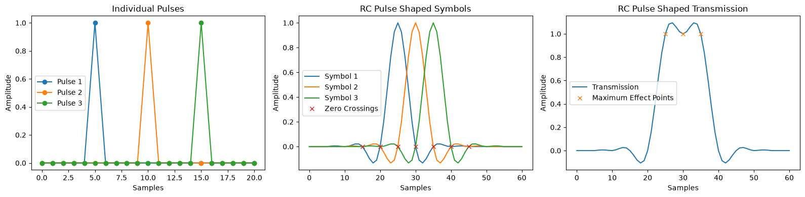

### 5. Согласованная фильтрация с фильтром корня из приподнятого косинуса (Root Raised Cosine — RRC)
Для оптимального приема сигналов в условиях шума фильтрацию разделяют поровну между передатчиком и приемником в виде пары согласованных фильтров:
$$
H_{\text{RC}}(f) = H_{\text{RRC}}(f) \cdot H_{\text{RRC}}(f)
$$
Импульсный отклик фильтра RRC $h(t)$:
$$
h(t) =
\begin{cases}
\frac{1}{T_s}\left(1 + \alpha\left(\frac{4}{\pi} - 1\right)\right), & t = 0 \\
\frac{\alpha}{T_s\sqrt{2}}\left[\left(1 + \frac{2}{\pi}\right)\sin\left(\frac{\pi}{4\alpha}\right) + \left(1 - \frac{2}{\pi}\right)\cos\left(\frac{\pi}{4\alpha}\right)\right], & t = \pm\frac{T_s}{4\alpha} \\
\frac{1}{T_s}\frac{\sin\left[\pi\frac{t}{T_s}(1-\alpha)\right] + 4\alpha\frac{t}{T_s}\cos\left[\pi\frac{t}{T_s}(1+\alpha)\right]}{\pi\frac{t}{T_s}\left[1 - \left(4\alpha\frac{t}{T_s}\right)^2\right]}, & \text{иначе}
\end{cases}
$$
Сам по себе один фильтр RRC вносит МСИ в излучаемый сигнал. Однако после прохождения второго идентичного фильтра RRC на приемной стороне суммарный отклик становится строго приподнятым косинусом (RC), и нулевая МСИ полностью восстанавливается:
```python
# Импульсный отклик RRC
h_rrc = 1/Ts * (np.sin(np.pi*x*(1-alpha)) + 4*alpha*x*np.cos(np.pi*x*(1+alpha))) / \
        (np.pi*x*(1 - (4*alpha*x)**2))
h_rrc[int(num_weights/2)] = 1/Ts * (1 + alpha*(4/np.pi - 1))
h_rrc = h_rrc / np.max(h_rrc)

# Прохождение импульса через один RRC фильтр
symbol1_rrc = np.convolve(pulse1, h_rrc).real

# Прохождение через согласованный фильтр приемника (второй RRC)
symbol1_matched = np.convolve(symbol1_rrc, h_rrc).real[20:-20]

fig, ax = plt.subplots(1, 2, figsize=(12, 4))
ax[0].plot(symbol1_rrc)
ax[0].set_title('RRC Pulse Shaped Symbol (With ISI)')

ax[1].plot(symbol1_matched)
ax[1].plot([15, 20, 25, 30, 35, 40, 45], [0]*7, 'x')
ax[1].set_title('After Matched Filtering (Zero-ISI Restored)')
plt.tight_layout()
plt.show()
```
Импульсный отклик после согласованной фильтрации RRC:  

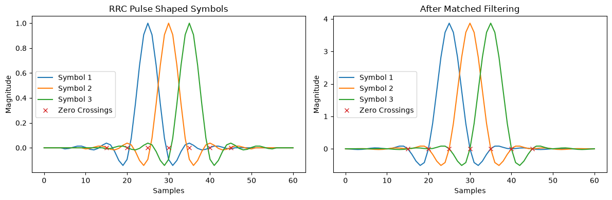


---

## Вывод к файлам 1, 2 и 3 набора Блокнот D

В ходе выполнения практических заданий данного модуля были изучены основные этапы синтеза и анализа систем цифровой связи в основной полосе частот:

1. **Базовая модуляция (Файл 1):** исследованы принципы дискретного отображения битовой информации в комплексные символы созвездий BPSK, QPSK и 16-QAM. Продемонстрирован компромисс между спектральной эффективностью (количеством бит на один символ) и плотностью точек на комплексной плоскости.
2. **Оценка качества канала и помехоустойчивость (Файл 2):** рассмотрена модель аддитивного белого гауссовского шума (AWGN) и методики количественной оценки искажений сигнала с помощью метрик EVM, BER и SER в зависимости от отношения $E_b/N_0$. Показано, что многоуровневые созвездия (16-QAM) требуют значительно более высокого уровня SNR по сравнению с BPSK/QPSK для достижения аналогичного уровня ошибок.
3. **Формирование импульсов и согласованная фильтрация (Файл 3):** изучена проблема внеполосных спектральных излучений при передаче неформированных импульсов и прямоугольных сигналов. На практике реализованы фильтры Sinc, Raised Cosine (RC) и Root Raised Cosine (RRC). Наглядно доказано, что разделение фильтра RC на два согласованных фильтра RRC на передающей и приемной сторонах обеспечивает максимальное отношение сигнал/шум на входе демодулятора при полном устранении межсимвольной интерференции (МСИ) в строгом соответствии с первым критерием Найквиста.
