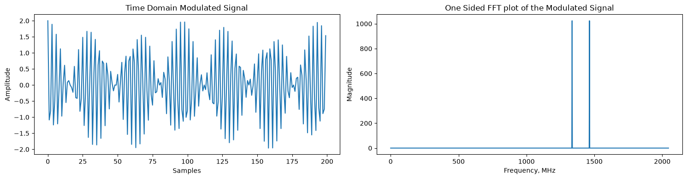
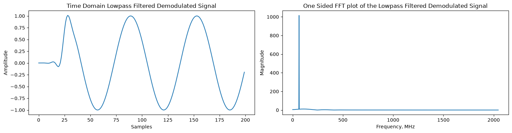
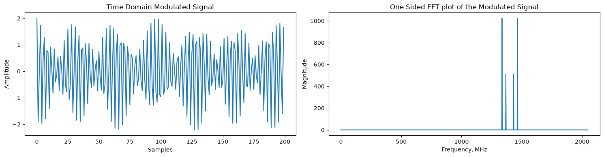
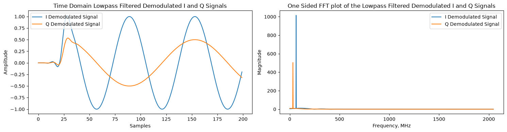
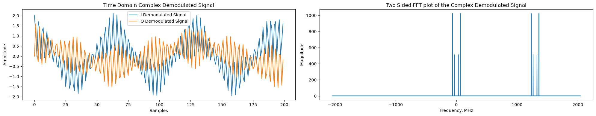
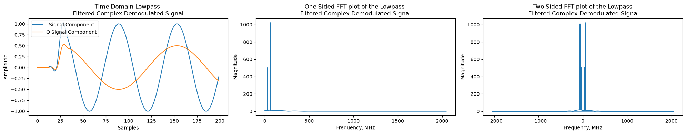

# Блокнот E

## Файл 1: Амплитудная модуляция (01 - Amplitude Modulation)

В данном файле рассматриваются базовые принципы переноса низкочастотного (Baseband) информационного сигнала на промежуточную (IF) или радиочастоту (RF) с использованием амплитудной модуляции (АМ), а также обратный процесс - демодуляция.

### 1. Амплитудная модуляция базового сигнала

Для моделирования задаются параметры системы: частота дискретизации $f_s = 4096\text{ МГц}$, частота информационного сигнала $f_b = 64\text{ МГц}$ и амплитуда $A = 2$.
Информационный сигнал $g(t)$ и высокочастотная несущая $c(t)$ (с частотой $f_c = 1400\text{ МГц}$) определяются как:
$$
g(t) = A\cos(2 \pi f_{b} t)
$$
$$
c(t) = \cos(2 \pi f_{c} t)
$$

Процесс модуляции заключается в перемножении этих сигналов:
$$
s(t) = c(t) \times g(t) = \cos(2 \pi f_{c} t) \times A\cos(2 \pi f_{b} t)
$$
Используя тригонометрические тождества, модулированный сигнал можно представить как сумму двух боковых полос:
$$
s(t) = \frac{A}{2} \cos(2 \pi (f_{c} - f_{b}) t) + \frac{A}{2} \cos(2 \pi (f_{c} + f_{b}) t)
$$

Реализация в коде Python выглядит максимально просто - через поэлементное умножение массивов:
```python
import numpy as np
import matplotlib.pyplot as plt

# Базовые параметры
fs = 4096e6
fb = 64e6
fc = 1400e6
A = 2
N_fft = 2048
t = np.arange(N_fft)/fs

# Генерация сигналов и модуляция
g = A*np.cos(2*np.pi*fb*t) 
c = np.cos(2*np.pi*fc*t) 
s = g * c

# Вычисление БПФ
s_fft_result = np.fft.fft(s, N_fft)
freqs = np.fft.fftfreq(N_fft, 1/fs)
```
Графики модулированного сигнала во временной области и его спектр (с компонентами на частотах $f_c - f_b$ и $f_c + f_b$):  


### 2. Демодуляция и фильтрация

На приемной стороне сигнал умножается на сигнал локального гетеродина, совпадающего по частоте с несущей:
$$
x(t) = c(t) \times s(t)
$$
В результате получается исходный сигнал на нулевой частоте, а также высокочастотные копии:
$$
x(t) = \frac{A}{2} \cos(2 \pi f_{b} t) + \frac{A}{4} \cos(2 \pi (2f_{c} - f_{b}) t) + \frac{A}{4} \cos(2 \pi (2f_{c} + f_{b}) t)
$$

Для выделения полезного сигнала применяется фильтр нижних частот (ФНЧ), спроектированный оконным методом (sinc-фильтр + окно Блэкмана):
$$
h(n) = w(n) \cdot h_d(n)
$$
```python
# Демодуляция
x = c * s 

# Проектирование ФНЧ
f_cutoff = 0.1
b = 0.08  
N = int(np.ceil((4 / b)))
if not N % 2: N += 1 
n = np.arange(N)

h = np.sinc(2 * f_cutoff * (n - (N - 1) / 2))
w = np.blackman(N)
h = (h * w) / np.sum(h * w) 

# Фильтрация
u = np.convolve(x, h)
```
После фильтрации восстанавливается исходный сигнал с амплитудой, уменьшенной в 2 раза ($u(t) = \frac{A}{2} \cos(2 \pi f_{b} t)$). Если фаза гетеродина не совпадает с фазой несущей на величину $\theta$, возникает дополнительное затухание, пропорциональное $\cos(\theta)$.

Восстановленный сигнал после ФНЧ:  



## Файл 2: Квадратурная амплитудная модуляция (02 - QAM Modulation)

Для устранения спектральной неэффективности АМ применяется квадратурная амплитудная модуляция (QAM). Она использует ортогональность синуса и косинуса для передачи двух независимых сигналов в одной полосе частот.

### 1. Формирование QAM-сигнала
Два информационных сигнала $g_1(t)$ и $g_2(t)$ модулируются синфазной (I) и квадратурной (Q) несущими соответственно:
$$
s_{1}(t) = g_{1}(t) \cos(2 \pi f_{c} t)
$$
$$
s_{2}(t) = -g_{2}(t) \sin(2 \pi f_{c} t)
$$

Результирующий сигнал является их суммой:
$$
y(t) = g_{1}(t) \cos(2 \pi f_{c} t) - g_{2}(t) \sin(2 \pi f_{c} t)
$$

```python
# Информационные сигналы разных частот
fb2 = 32e6 
A1, A2 = 2, 1
g1 = A1*np.cos(2*np.pi*fb*t)
g2 = A2*np.cos(2*np.pi*fb2*t)

# Синфазный и квадратурный каналы
s1 = g1*np.cos(2*np.pi*fc*t)
s2 = -g2*np.sin(2*np.pi*fc*t)

# Формирование QAM
y = s1 + s2 
```
Временная диаграмма и спектр сформированного QAM-сигнала:  


### 2. Квадратурная демодуляция
На приемнике сигнал умножается отдельно на синфазный и квадратурный гетеродины, после чего проходит через ФНЧ для удаления высокочастотных удвоенных гармоник (около $2f_c$):
$$
x_{1}(t) = y(t) \cos(2 \pi f_{c} t) \xrightarrow{\text{ФНЧ}} z_{1}(t) = 0.5g_{1}(t)
$$
$$
x_{2}(t) = y(t)( -\sin(2 \pi f_{c} t)) \xrightarrow{\text{ФНЧ}} z_{2}(t) = 0.5g_{2}(t)
$$

```python
# Демодуляция I и Q
x1 = y*np.cos(2*np.pi*fc*t) 
x2 = y*(-np.sin(2*np.pi*fc*t)) 

# Фильтрация ФНЧ (используется фильтр h из предыдущего примера)
z1 = np.convolve(x1, h)
z2 = np.convolve(x2, h)
```
Оба сигнала успешно восстанавливаются. При наличии фазовой ошибки $\theta$ на приемнике каналы I и Q начинают смешиваться, вызывая перекрестные помехи (crosstalk).

Спектры демодулированных сигналов I и Q:  



## Файл 3: Комплексное представление QAM (03 - Complex Representation of QAM)

Математическое описание QAM значительно упрощается при переходе к комплексной форме. В этом случае используется единый комплексный информационный сигнал и комплексная экспонента в качестве гетеродина.

### 1. Комплексная модуляция
Комплексный огибающий сигнал формируется из синфазной и квадратурной компонент:
$$
g(t) = g_{1}(t) + jg_{2}(t)
$$
Сам процесс модуляции представляет собой умножение на экспоненту (в соответствии с формулой Эйлера $e^{j 2 \pi f_{c} t} = \cos(2 \pi f_{c} t) + j \sin(2 \pi f_{c} t)$):
$$
v(t) = g(t)e^{j 2 \pi f_{c} t} = [g_{1}(t) + jg_{2}(t)][\cos(2 \pi f_{c} t) + j \sin(2 \pi f_{c} t)]
$$

Излучаемый в эфир реальный (физический) сигнал - это действительная часть $v(t)$:
$$
y(t) = \text{Re}\{v(t)\} = g_{1}(t) \cos(2 \pi f_{c} t) - g_{2}(t) \sin(2 \pi f_{c} t)
$$

```python
# Комплексный информационный сигнал
g_complex = g1 + 1j*(g2)

# Комплексная несущая
c_complex = np.exp(1j*2*np.pi*fc*t)

# Комплексная модуляция
v = g_complex * c_complex

# Передаваемый в эфир сигнал (только вещественная часть)
y = v.real
```
Комплексный спектр до и после модуляции:  


### 2. Комплексная демодуляция
Для демодуляции принятый радиосигнал $y(t)$ умножается на комплексно-сопряженную экспоненту гетеродина $e^{-j 2 \pi f_{c} t}$, сдвигающую спектр обратно к нулю. После этого применяется ФНЧ:
$$
x(t) = y(t)e^{-j 2 \pi f_{c} t}
$$
$$
z(t) = \text{ФНЧ}\{x(t)\} = 0.5[g_{1}(t) + jg_{2}(t)]
$$

```python
# Комплексный гетеродин приемника
complex_demod_carrier = np.exp(-1j*2*np.pi*fc*t)

# Демодуляция (сдвиг спектра)
x = y * complex_demod_carrier

# ФНЧ
z = np.convolve(x, h)
```
Результат комплексной демодуляции совпадает с классической квадратурной схемой, но реализуется программно значительно элегантнее.

Спектр восстановленного комплексного сигнала:  


---

## Вывод к файлам 1, 2 и 3 набора Блокнот E

Изучение материалов данного блока позволяет понять физический и математический смысл процессов переноса спектра сигналов:

1. **Амплитудная модуляция (Файл 1):** демонстрирует базовый принцип умножения информационного сигнала на высокочастотную несущую, что в частотной области приводит к сдвигу базового спектра на частоту $\pm f_c$. Показано, что классическая АМ требует удвоенной полосы пропускания канала (спектральная неэффективность).
2. **Квадратурная модуляция QAM (Файл 2):** решает проблему ширины спектра за счет использования свойства ортогональности тригонометрических функций. Передача двух независимых потоков данных в синфазном (I) и квадратурном (Q) каналах позволяет удвоить скорость передачи данных в той же полосе частот, однако предъявляет более высокие требования к фазовой синхронизации (PLL) на стороне приемника.
3. **Комплексное представление QAM (Файл 3):** является основой современной цифровой обработки сигналов (DSP) и программно-определяемых радиосистем (SDR). Переход к комплексным огибающим (IQ-данным) и комплексным экспоненциальным гетеродинам значительно упрощает математический аппарат, позволяя реализовать модуляцию и демодуляцию с помощью одной комплексной операции умножения вместо нескольких вещественных преобразователей.